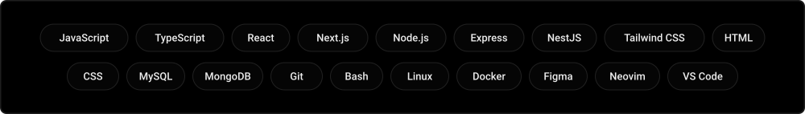

  

  <em>16-year-old web developer building on the web — learning fast, shipping often, and collaborating with people who care about the details.</em>

  
  
  

  

### About

- **Currently** — learning new stacks and advanced backend systems.
- **Ask me about** — anything tech; I'm always picking up something new.
- **Reach me** — [ammaarfauzaan@gmail.com](mailto:ammaarfauzaan@gmail.com).
- **Fun fact** — I started coding because of a hobby and never stopped.

  

### Tech Stack

  

  

### GitHub Stats

  
  

  

  

### Top Repositories

  
  

  

Designed and built with care · <a href="https://github.com/ammaar-engineer">@ammaar-engineer</a>

