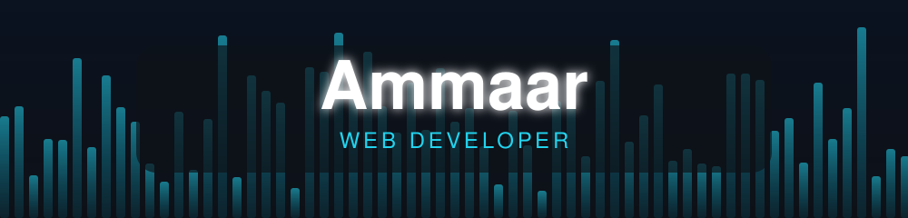

  

  I'm a 16-year-old web developer who got into tech through a hobby. I love learning new things and collaborating with others.

  
  
  

---

### 🧑‍💻 About Me

- 🔭 &nbsp;I'm currently learning **NestJS** and advanced backend systems
- 💬 &nbsp;Ask me about anything tech — I love learning new things
- 📫 &nbsp;Reach me at **ammaarfauzaan@gmail.com**
- ⚡ &nbsp;Fun fact: I started coding because of a hobby and never stopped

---

### 🛠️ Tech Stack

  

---

### 📊 GitHub Stats

  
  

  

---

### 📌 Top Repositories

  
  

  

